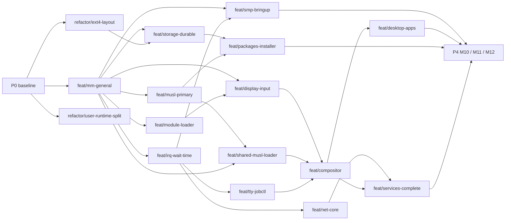

# ObfuscationProject plan

Workspace-level execution plan, written 2026-10-24 from the architecture
review. Component plans: ObfuscationKernel `docs/PLAN.md`, ObfuscationOS
`docs/PLAN.md`, SysToolchain `PLAN.md`, ObfuscationRepo `PLAN.md`,
ObfuscationEvidence `PLAN.md`. The target and the M0–M12 exit gates are in
ObfuscationOS `docs/plans/README.md`; nothing here closes a gate.

## Rules

- Paired worktrees under `wt/`: `python3 scripts/wt_pair.py --topic NAME` creates
  `wt/kernel-NAME` and `wt/os-NAME` (`--os-topic`/`--os-kind` when the OS
  branch differs, as in every P2 pair); the OS side consumes the kernel side's
  SDK export. A worktree lives at most 4–6 weeks.
- Fast lane everywhere: x86_64, arm32 (32-bit), ppc (big-endian). Full ten
  profiles before merging architecture-sensitive work.
- Evidence goes to ObfuscationEvidence, never into a product tree.
- `manifest.json` pins the component commits that were validated together;
  `python3 scripts/sync.py --pin` after each promotion.

## P0: baseline (done 2026-10-24, audited 2026-10-25)

| Item | Result |
| --- | --- |
| Land five weeks of uncommitted work | Kernel `chore/land-2026-10` (10 subsystem commits), OS `chore/land-2026-10` (8 area commits), tag `sdk-abi74-uapi0.16` in both |
| Umbrella repository | This repository: manifest, `scripts/sync.py`, `scripts/wt_pair.py`, `scripts/workspace.py` (`sdk-all`, `distro-all`, `matrix`) |
| Evidence tree | Moved to `ObfuscationEvidence/archive/` (ignored), small text evidence versioned, `build` symlink keeps historical paths valid |
| Build hygiene | SimpleFS rescue image fits without a format change (F1); CI consumes the SysToolchain release archives (installed package cached per architecture, job timeouts), runs a three-architecture fast lane and exports SDK artifacts; xmake layout documented |
| Documentation | 133 per-slice notes moved to `docs/qualification/` in both repositories; stale ABI/QEMU/profile statements fixed; progress log frozen; `STATUS.md` generated from the ledger; decision records 0001–0003 |
| Clutter | Root `.git`, `.agents`, `.codex`, `.aws`, `.xmake`, `rename-uncertainty-attempt-01` and the empty `modules/system-apps` removed; empty `.agents`/`.codex` in Kernel and OS removed |

Audit of 2026-10-25. Pins, tags, the ledger-generated `STATUS.md`, the decision
records and the evidence layout were re-checked; the local fast lane (x86_64,
arm32, ppc) and the x86_64 ext4 and SimpleFS boots pass. The CI row had never
held: no Kernel or OS run had completed since May.

- SysToolchain `v0.1.0` failed in all ten jobs at the static QEMU + SDL2 link,
  and the package source build failed at the xmake-repo libsdl2 install and then
  hung every job for six hours. QEMU now links the host GLib, Pixman and SDL2
  dynamically with `--without-default-features`; the release job declares
  `python3-tomli` and `gawk`; the recipe's source fallback uses host development
  files. All ten archives were built, verified and relocated in `ubuntu:22.04`.
- Kernel and OS resolve the release archives, CI installs the QEMU runtime
  libraries and jobs time out after 60–90 minutes.
- The pinned QEMU 10.2.0 enforces alignment for MMU-off (Device memory)
  accesses, which exposed unaligned accesses in Arm kernel code: aarch64 and
  arm32 stopped at boot. Fixed with `-mstrict-align` / `-mno-unaligned-access`;
  all ten kernel profiles pass `xmake test` on the packaged QEMU, and x86_64 and
  arm32 pass every OS CI step on it.

SysToolchain `v0.1.0` was published on 2026-10-25 (ten archives with checksums,
built by the release workflow) and the Kernel CI passes on all ten profiles.

The OS `artifact-test` step then failed in CI (19 of 1268 tests read the sibling
kernel checkout; four suites assumed x86_64). Suites that need the checkout now
skip without it and run in the workspace lane (`workspace.py cross-tests`), and
the OS CI passes on x86_64 and arm32. The ppc distro step was refused at startup
because `qemu-distro` never selected the e500v2 profile that native PPC ELF
admission requires; it now does, and the full OS CI fast lane passes on the
pinned QEMU 10.2.0 (QEMU 8.2 still stops after timer preemption on ppc).

The standalone kernel qualification scripts now carry the same Arm alignment
flags.

Still open: the journalled-image dependency on a Linux kernel image (OS `fix/mkfs-e2fsprogs`,
needs an e2fsprogs package, P2); and the code refactors below.

## P1: foundations

| Worktree | Component | Size | Depends on |
| --- | --- | --- | --- |
| `feat/mm-general` | Kernel (paired OS `chore/sdk75-consumer`) | XL | P0 |
| `feat/irq-wait-time` | Kernel | L | mm-general |
| `refactor/ext4-layout` | Kernel (paired OS `refactor/ext4-layout`) | M | — (align ABI at merge) |
| `refactor/user-runtime-split` | Kernel | M | — |
| `feat/musl-primary` | OS (freestanding-GCC fallback until the SysToolchain 0.2.0 musl family) | L | mm-general |

Merged: `refactor/user-runtime-split` (kernel PR #1, tag `p1-user-runtime-split`,
ABI 74); `feat/mm-general` with OS `chore/sdk75-consumer` (kernel PR #2, OS PR #4,
tag `sdk-abi75-uapi0.16` in both, module ABI 75); `refactor/ext4-layout` with OS
`refactor/ext4-layout` (kernel PR #3, OS PR #5, tag `sdk-abi76-uapi0.16` in both,
module ABI 76); OS `feat/musl-primary` (OS PR #6, tag `p1-musl-primary`, against
the ABI 76 kernel): BusyBox 1.37.0 on static musl as `/bin` on ten profiles,
guest sh gate on eight. Its exit gate waits for kernel work on `execve`
argv/envp limits and ENOEXEC, the 128-inode ext4 node cache, path component
length, device nodes, unrouted syscalls and MIPS signal-handler resume (OS
`docs/qualification/MUSL_USERLAND.md`).

Review of 2026-10-28: the workspace fast lane (kernel build, `xmake test`, SDK
export, OS consumer, cross-tests) passed on x86_64, arm32 and ppc. The
standalone QEMU execution probes, broken by `feat/mm-general`, were restored and
the runtime-split ratchet and the P1 hosted suites run in CI (Kernel PR #9).
Filed: Kernel #4–#8, OS #7 (musl userland not in CI), SysToolchain #1
(powerpc-eabi without the soft-float multilib).

Merged 2026-10-29: Kernel `chore/hosted-runners` (PR #10, issue #5, every
hosted runner classified and run in CI), `fix/mips-signal-resume` (PR #11,
#8), `fix/ext4-node-cache` (PR #12, #7) and `feat/linux-personality` (PR #13,
#6, module ABI 77 for all four), with OS `fix/ext4-node-cache` and
`feat/linux-personality` (OS PRs #8 and #9); tag `sdk-abi77-uapi0.16` in both.
On ten profiles the musl `/bin` passes 54 sh checks and the BusyBox gate
suite except 8 reviewed failures (31-byte path components). Receipts:
ObfuscationEvidence `receipts/ObfuscationKernel@6968183/feat/linux-personality/`
and `receipts/ObfuscationOS@9d9bae5/feat/linux-personality/`.

Merged 2026-10-31: Kernel `feat/irq-wait-time` (PR #14, issue #4, module ABI
78) with OS `feat/irq-wait-time` (OS PR #10); tag `sdk-abi78-uapi0.16` in both.
Interrupt controllers on ten profiles and the idle wait on interrupts; virtio
block, net and RNG (OS) and the kernel's input complete through interrupts from
the root mount on; Linux `ITIMER_REAL`, `alarm` and the `timer_create` family.
Exit gate: no device wait polled in a shell gate run on ten profiles, the
monotonic clock within 100 ppm of the host's (the PC TSC calibration was 500-700
ppm off and is fixed), timer interrupt latency measured for idle and user ticks
(kernel `docs/qualification/PLATFORM_INTERRUPTS.md`). A four-round pre-merge
review fixed the defects it found before the merge. Receipts: ObfuscationEvidence
`receipts/ObfuscationKernel@1249613/feat/irq-wait-time/` and
`receipts/ObfuscationOS@27ec4c0/feat/irq-wait-time/`. All five P1 worktrees are
merged; the BusyBox gate suite's 8 reviewed failures stay open.

## P2: platform and protocols

| Worktree | Component | Size | Depends on |
| --- | --- | --- | --- |
| `feat/smp-bringup` | Kernel | XL | mm-general, irq-wait-time |
| `feat/tty-jobctl` + `feat/getty-login` | Kernel + OS | L | irq-wait-time |
| `feat/net-core` + `feat/net-services` | Kernel + OS | XL | irq-wait-time |
| `feat/storage-durable` + `fix/mkfs-e2fsprogs` | Kernel + OS | XL | mm-general, ext4-layout |
| `feat/module-loader` + `feat/drivers-as-modules` | Kernel + OS | L | mm-general |
| `feat/display-input-uapi` + `feat/display-input-drivers` | Kernel + OS | L | mm-general, module-loader |

## P3: user environment and desktop

| Worktree | Component | Size | Depends on |
| --- | --- | --- | --- |
| `feat/shared-musl-loader` | OS | L | musl-primary, mm-general |
| `feat/compositor` | OS | XL | display-input, shared-musl-loader, tty-jobctl |
| `feat/desktop-apps` | OS | L | compositor |
| `feat/packages-installer` | OS | L | storage-durable, musl-primary |
| `feat/services-complete` | OS | M | net-services, compositor |

## P4

M10 ext4 feature breadth, M11 physical reference machines, M12 release
qualification; per-feature and per-board worktrees.

## Dependency graph

Sizes are single-person, full-time rough estimates used only for ordering:
S 1–2 weeks, M 3–5, L 6–10, XL more than 10.
