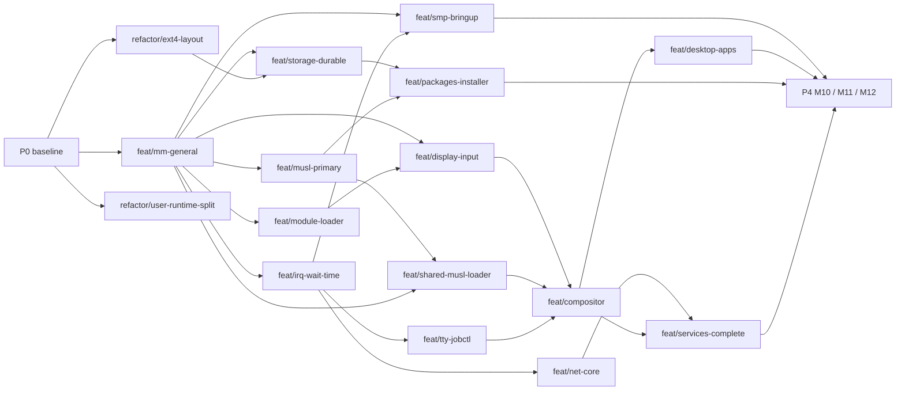

# ObfuscationProject plan

Workspace-level execution plan, written 2026-10-24 from the architecture
review. Component plans: ObfuscationKernel `docs/PLAN.md`, ObfuscationOS
`docs/PLAN.md`, SysToolchain `PLAN.md`, ObfuscationRepo `PLAN.md`,
ObfuscationEvidence `PLAN.md`. The target and the M0–M12 exit gates are in
ObfuscationOS `docs/plans/README.md`; nothing here closes a gate.

## Rules

- Paired worktrees under `wt/`: `xmake wt-pair --topic=NAME` creates
  `wt/kernel-NAME` and `wt/os-NAME`; the OS side consumes the kernel side's SDK
  export. A worktree lives at most 4–6 weeks.
- Fast lane everywhere: x86_64, arm32 (32-bit), ppc (big-endian). Full ten
  profiles before merging architecture-sensitive work.
- Evidence goes to ObfuscationEvidence, never into a product tree.
- `manifest.json` pins the component commits that were validated together;
  `python3 scripts/sync.py --pin` after each promotion.

## P0: baseline (done 2026-10-24)

| Item | Result |
| --- | --- |
| Land five weeks of uncommitted work | Kernel `chore/land-2026-10` (10 subsystem commits), OS `chore/land-2026-10` (8 area commits), tag `sdk-abi74-uapi0.16` in both |
| Umbrella repository | This repository: manifest, `scripts/sync.py`, `scripts/wt_pair.py`, meta tasks `sdk-all`, `distro-all`, `matrix`, `wt-pair`, `sync` |
| Evidence tree | Moved to `ObfuscationEvidence/archive/` (ignored), small text evidence versioned, `build` symlink keeps historical paths valid |
| Build hygiene | SimpleFS rescue image fits without a format change (F1); CI caches the toolchain, runs a three-architecture fast lane and exports SDK artifacts; xmake layout documented |
| Documentation | 133 per-slice notes moved to `docs/qualification/` in both repositories; stale ABI/QEMU/profile statements fixed; progress log frozen; `STATUS.md` generated from the ledger; decision records 0001–0003 |
| Clutter | Root `.git`, `.agents`, `.codex`, `.aws`, `.xmake`, `rename-uncertainty-attempt-01` and the empty `modules/system-apps` removed |

Still open from the review: the journalled-image dependency on a Linux kernel
image (OS `fix/mkfs-e2fsprogs`, needs an e2fsprogs package), publishing the
SysToolchain 0.1.0 release so CI can stop building GCC from source, and the
code refactors below.

## P1: foundations

| Worktree | Component | Size | Depends on |
| --- | --- | --- | --- |
| `feat/mm-general` | Kernel (paired OS `chore/sdk75-consumer`) | XL | P0 |
| `feat/irq-wait-time` | Kernel | L | mm-general |
| `refactor/ext4-layout` | Kernel | M | — (align ABI at merge) |
| `refactor/user-runtime-split` | Kernel | M | — |
| `feat/musl-primary` | OS (needs SysToolchain 0.2.0 musl family) | L | mm-general |

## P2: platform and protocols

| Worktree | Component | Size | Depends on |
| --- | --- | --- | --- |
| `feat/smp-bringup` | Kernel | XL | mm-general, irq-wait-time |
| `feat/tty-jobctl` + `feat/getty-login` | Kernel + OS | L | irq-wait-time |
| `feat/net-core` + `feat/net-services` | Kernel + OS | XL | irq-wait-time |
| `feat/storage-durable` + `fix/mkfs-e2fsprogs` | Kernel + OS | XL | mm-general, ext4-layout |
| `feat/module-loader` + `feat/drivers-as-modules` | Kernel + OS | L | mm-general |
| `feat/display-input-uapi` + `feat/display-input-drivers` | Kernel + OS | L | mm-general, module-loader |

## P3: user environment and desktop

| Worktree | Component | Size | Depends on |
| --- | --- | --- | --- |
| `feat/shared-musl-loader` | OS | L | musl-primary, mm-general |
| `feat/compositor` | OS | XL | display-input, shared-musl-loader, tty-jobctl |
| `feat/desktop-apps` | OS | L | compositor |
| `feat/packages-installer` | OS | L | storage-durable, musl-primary |
| `feat/services-complete` | OS | M | net-services, compositor |

## P4

M10 ext4 feature breadth, M11 physical reference machines, M12 release
qualification; per-feature and per-board worktrees.

## Dependency graph

Sizes are single-person, full-time rough estimates used only for ordering:
S 1–2 weeks, M 3–5, L 6–10, XL more than 10.
